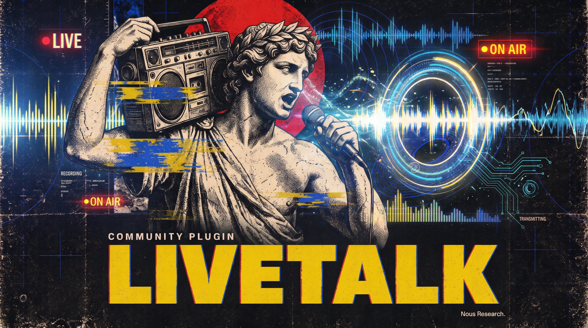
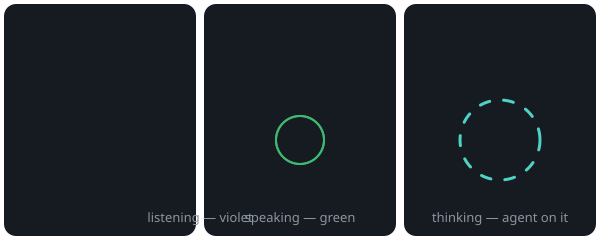

<p align="center"></p>

# Livetalk

<p align="center"></p>

<p align="center"><b>Talk to it. It talks back — and when real work is needed, the Hermes agent does it.</b></p>

<p align="center"><a href="docs/demo.html">✨ See the face-ghost move (live demo)</a></p>

> **What's Hermes?** [Hermes Agent](https://github.com/NousResearch/hermes-agent) is the open-source AI agent by [Nous Research](https://nousresearch.com) that lives in your desktop app — it chats, runs tools, browses the web, remembers things, and automates your work. This plugin gives it a voice you can talk to.

A composer mini-bar for the Hermes desktop app: a full-duplex Livetalk voice session in one small popover. Small talk is answered by the voice model itself; anything that needs facts, your machine, or tools is handed to a dedicated Hermes agent session, and the answer is spoken back to you.

> The renderer never talks to Google. A local Python backend owns the upstream WebSocket and your API key; the desktop UI only exchanges data with `localhost`.

---

## What you get

- **Voice ↔ Hermes delegation** — the voice model routes each turn: greetings and general knowledge it answers itself; anything needing live data, your machine, or tools is delegated via an `talk` call to a dedicated **"Livetalk" agent session** (auto-created, persistent memory), and the agent's final answer is spoken aloud.
- **Full-duplex + barge-in** — talk over Gemini mid-sentence. The client detects your voice while playback is live and cuts the queue immediately; the server-side interruption path handles the mid-generation case.
- **Liquid blob indicator** — the status bar shows one animated blob instead of text: violet and swelling with your voice while listening, green and pulsing with Gemini's actual spoken output while answering, spinning teal while the agent works. Click it to start/stop.
- **Native settings page** — Settings → Plugins → livetalk: model, primary/second transcription language (every BCP-47 language the Live API documents), SMART transcription, spoken-answer detail, transcript/log visibility. Rendered and persisted by Hermes itself (`config_schema`).
- **Live transcript** — both sides rendered as flowing sentences (streaming fragments merged per speaker). Toggleable.
- **Session token meter** — real `usageMetadata` from Google, shown as `12.3k tok`, reset per session. Handy on the free tier.
- **Session resumption + auto-redial** — a network drop reconnects itself with the resumption handle, keeping context. A manual stop never reconnects.
- **Secure by design** — the API key lives in your Hermes `.env` (`~/.hermes/.env`, or `<profile>/.env` under `~/.hermes/profiles/` when you run a named profile) and never leaves the backend process. The UI gets short-lived single-use ephemeral tokens (Google's recommended browser flow).

## Requirements

| | |
|---|---|
| **Hermes** | Desktop app with plugin support; **tested on v0.23.1** (`requires_hermes: >=0.22.0`). The native settings page needs a build with `registerSettingsPage` (~0.23+); older builds run everything else and simply hide that page. |
| **API key** | A Google AI Studio key with Live API access — [get one](https://aistudio.google.com/apikey), set as `GOOGLE_API_KEY` in your Hermes `.env` — `~/.hermes/.env`, or `~/.hermes/profiles/<name>/.env` for a named profile |
| **Python** | Nothing extra — the backend uses only Hermes-bundled packages (`fastapi`, `websockets`) |
| **Hardware** | Microphone + speakers/headphones (headphones strongly recommended — see Tips) |
| **OS** | Windows / macOS / Linux desktop |

## Install

From your Hermes environment:

```bash
hermes plugins install cruzlxyz/livetalk
```

This installs both halves (the Python dashboard backend and the desktop mini-bar), then restart the desktop app once.

**One-time setup** — put your Gemini API key in your Hermes `.env`:

```
GOOGLE_API_KEY=AIza...
```

That file is `~/.hermes/.env`, or `~/.hermes/profiles/<name>/.env` when you run a named Hermes profile (the Providers page in the Hermes dashboard writes it there). The backend reads the process environment first and falls back to both files, so either location works.

Then click the blob in the status bar and just talk.

## Usage

- **Click the blob** to start; click again to stop.
- **Just talk.** Examples of how turns route:

| You say | What happens |
|---|---|
| "What is Hermes anyway?" | The voice model answers itself — general knowledge |
| "What's the BTC price right now?" | Delegated — the agent searches the live web, the answer is spoken |
| "Check how many files are in my Downloads folder" | Delegated — the agent runs tools on your machine |
| "Remind me at 8 tomorrow" | Delegated — memory/scheduling |
| "Wait, how many percent did you say?" | Answered from context — no re-search |

- **Blob colors**: violet = listening · green = Gemini speaking · spinning teal = Hermes is on it · gray = idle.

<p align="center"></p>

- **Context first**: follow-up questions are answered from what was already said or already worked out — no repeated searches.
- Use **headphones**: without them the microphone re-captures Gemini's voice, which is the #1 cause of chaotic replies in every voice app.
- Google caps Live audio sessions (~15 min); the backend auto-resumes on network drops.

## Settings (Settings → Plugins → livetalk)

| Setting | Values | Default |
|---|---|---|
| Live model | every Live-capable model on your key | `gemini-3.8-live` |
| Primary language | any documented Live API language (BCP-47) | `id-ID` |
| Second language | `none` or any language — covers mid-sentence code-switching | `en-US` |
| Smart transcription | on/off — removes fillers, fixes false starts | on |
| Spoken answers | `full` (every key fact) / `brief` (2–4 sentences) | `full` |
| Show transcript | on/off (popover conversation text) | on |
| Show diagnostic log | on/off (timestamped event log) | on |

## What this plugin touches

- **Dashboard API** (`dashboard/plugin_api.py`): FastAPI routes under `/api/plugins/livetalk/*` — session proxy, delegation queue, settings reads.
- **Desktop surface** (`desktop/plugin.js`): one composer blob + popover (blob control, token counter, transcript, log).
- **One agent session**: creates and reuses a Hermes session titled "Livetalk" for all delegations. No agent tools, no hooks, no middleware, no core overrides.

### API routes

| Method | Route | Purpose |
|---|---|---|
| `GET` | `/config` | `{ model, candidates[], prefs }` — model catalog + current settings |
| `POST` | `/start` | Dial Google: mint ephemeral token → connect → `setupComplete`. Returns `{ ok, model, resumed, speak }` |
| `POST` | `/audio` | Forward one mic chunk upstream (`{ data: <base64 PCM16 mono 16kHz> }`) |
| `GET` | `/poll` | Incremental state: transcriptions, audio, delegations, usage, barge-in counter, settings echo — all offset-based |
| `POST` | `/tool_response` | Answer a queued `talk` delegation; forwarded upstream as the tool response |
| `POST` | `/close` | Tear down the session (blocks auto-redial) |
| `GET` | `/status` | Liveness probe |

## How it works

Two flows, one router — the voice model itself decides per turn (guided by its persona):

1. **Small talk / general knowledge** → answered directly over the audio channel.
2. **Real work** → the model emits an `talk(request)` tool call → the renderer submits it to the dedicated agent session (`prompt.submit`, surface `voice-live`, with the recent spoken context) → polls the submission receipt until it settles → the agent's `final_response` is fed back as the tool response → spoken aloud.

Full details and diagrams: [docs/WORKFLOW.md](docs/WORKFLOW.md).

```
┌─ Hermes desktop (Electron renderer) ────────────┐
│  composer blob + popover (plugin.js)            │
│  mic capture (WebAudio PCM16/16k)               │
│  playback + output level analyser (24k)         │
│  delegation dispatch + receipt polling          │
└──────────────┬──────────────────────────────────┘
               │ ctx.rest() → localhost only
┌──────────────▼──────────────────────────────────┐
│  Backend (plugin_api.py, FastAPI router)        │
│  • mints 1-use ephemeral tokens (30 min TTL)    │
│  • owns the upstream Live WebSocket             │
│  • queues talk calls, forwards answers    │
│  • reads the official plugin settings store     │
└───────┬────────────────────────┬────────────────┘
        │ wss://…Constrained     │ prompt.submit / prompt.receipt
        ▼                        ▼
   Gemini Live API        Hermes agent session
   (v1alpha)              "Livetalk" (full toolset)
```

## Compatibility notes

- **`gemini-3.8-live-extended-thinking`** chats with deep reasoning but **cannot delegate**: per the official thinking guide its tool calls are async-only (`NON_BLOCKING`), and the plugin implements that contract — but the server currently never emits the call (verified across endpoints, API versions, and thinking levels as of Nov 2026). The picker labels it honestly; the async protocol is already wired for when that changes.
- **Native settings page** needs a Hermes build with plugin settings pages (~0.23+). Older builds: everything works, the page just does not appear.
- Transcription language hints follow the [Live API transcription docs](https://aistudio.google.com/docs/live-api/live-transcribe) (`languageCodes`, SMART mode, custom vocabulary).

## Privacy

Transcripts and audio exist only in memory while a session runs; the plugin writes no transcripts to disk. Your API key never leaves the backend process. On Google's side, the API key owner's data-use policy applies.

## License

MIT — see [LICENSE](LICENSE).
