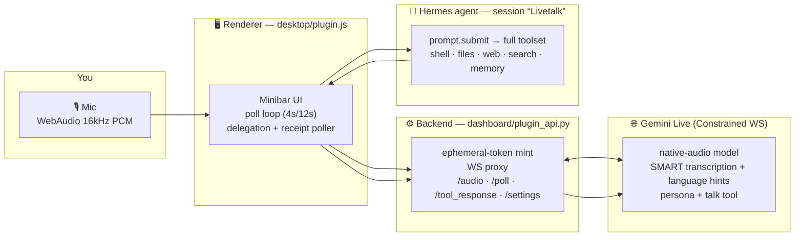

# How Livetalk works

The plugin is one bridge with two halves and one rule: **the renderer never talks to Google — only the backend does.**

## Flow A — small talk (Gemini answers alone)

1. You speak → the renderer streams 16 kHz PCM via `POST /audio`.
2. The backend relays `realtimeInput` upstream over the one real WebSocket (ephemeral token minted per session, retry-safe redial).
3. Gemini transcribes (SMART mode + your language hints) and answers with audio + `outputTranscription`.
4. The poll loop returns transcript + 24 kHz audio by offset; the minibar plays it.
5. Greetings and chit-chat never touch Hermes (persona: handle them yourself).

## Flow B — real work (delegated to the Hermes agent)

1. You ask something that needs facts or tools.
2. The persona's **delegation policy** + the `talk(request)` function declaration make Gemini hand over instead of guessing → `toolCall`.
3. `GET /poll` exposes the delegation (`d_offset`); the renderer dispatches it and flips the minibar to **"🧠 Hermes is on it…"**.
4. `targetSession()` resolves the dedicated **"Livetalk"** session: `session.list` by title, `session.create` on first use — one persistent home for voice work.
5. `host.request('prompt.submit', { session_id, text: VOICE_NOTE + request, surface: 'voice-live', voice_context })` → the agent works with its full toolset → receipt returns an `admission_id`.
6. The receipt poller hits `prompt.receipt` (`session_id`, `admission_id`, `include_result: true`) every 2 s until the admission is **terminal** (5-minute cap, cancelled on Stop).
7. `result.final_response` → `POST /tool_response { id, answer }` → the backend forwards a `toolResponse` upstream.
8. Gemini speaks the answer, the status returns to "Live — just talk".

## Safeguards

- **Redial**: any socket error retries the next candidate model; user-initiated starts reset the redial budget.
- **Session resumption**: the last handle is stored in `dashboard/.resume.json`; a stale handle falls back to a fresh session (deleting the file forces a clean context).
- **Receipt cap**: an unanswered delegation times out after 5 minutes and tells the voice side, so the model never hangs forever.
- **Settings migration**: old `lang` preset keys migrate to the primary/secondary/smart trio in `dashboard/.settings.json`; unknown codes are rejected server-side.
